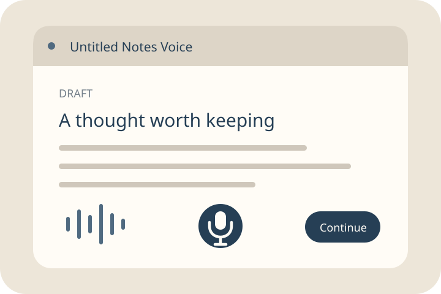

  

# Untitled Notes Voice

  

Didn't work? Create a Studio workspace and paste this to your agent:
` /use-template https://github.com/boweiliu/untitled-notes-voice`

## Why you care

Draft messages with on-device voice dictation, then send them to chats across your Imbue Studio machines.

Capture a thought while it is fresh, then shape it before sending. Keep several drafts and dictate into the one you are editing without choosing a chat first.

## How to use it

1. Open **Untitled Notes Voice** in Studio. Type a draft and optional title; edits save automatically. Use the draft list to switch or create another.
2. For dictation, visit the app's HTTPS address in a standalone browser tab and allow the microphone. Current Studio frames block it. Click the mic to begin/stop; right-click or long-press for Moonshine Base (default), v2 Tiny, Small or Medium. v2 needs an isolated top-level tab; Small can fall behind on modest CPUs. First use downloads the model; no speech API key is required.
3. Choose Continue, select a machine and a new or existing chat, choose provider/model/effort, review, then send. Local sends use the AI account you already connected to Studio. Linked machines need optional workspace read and SSH permission.
4. Check the outbox and destination. Uncertain sends retain your words and never automatically resend. A new chat may be created before the prompt is visible in history, so inspect it before retrying.

Audio stays in your browser. Typed and recognized text is autosaved on your workspace server and sent to your chosen chat when you send it. This template includes no personal drafts or recordings.

The full workspace installs the native package and registers port 8096. For installation and test commands see the [app guide](system/apps/untitled_notes_voice/README.md); activation details are in [the manifest](template.md).

## Ideas for making it yours

- Add reusable draft starters for bug reports, meeting follow-ups or research questions.
- Add a word-count target or a compact editing checklist before sending.
- Add a destination shortcut for the chat you use most often.
- Offer a plain-text export of selected drafts.

## What this is

This repository is a published **Imbue Studio template**: a clean, bootable
snapshot of what an agent built, ready to adapt into your own. It is NOT the
generic workspace template -- it is this specific project.

[`template.md`](template.md) is the full manifest -- what it is, how it
works, what it needs to run, and what to adapt -- with the
machine-readable half (recipe, requirements, and the environment it needs
installed) in [`template.toml`](template.toml).

## Credits and provenance

Browser voice modules build on [Local Vocal](https://github.com/DanverImbue/local-vocal), Moonshine, Silero VAD, ONNX Runtime Web and Transformers.js. Original module attribution is retained. Published under the [MIT license](LICENSE).

First publication packages external voice source `16a40263d4f303b804e4d866a0600e26c4eddf21` from `boweiliu/prompt-notes` alongside source workspace `8fc760b88fdcba8bd41ccecda5219315689ace90`. The private source is provenance, not an installation dependency. Future updates explicitly stage that external source before applying the [publication recipe](template.toml).
